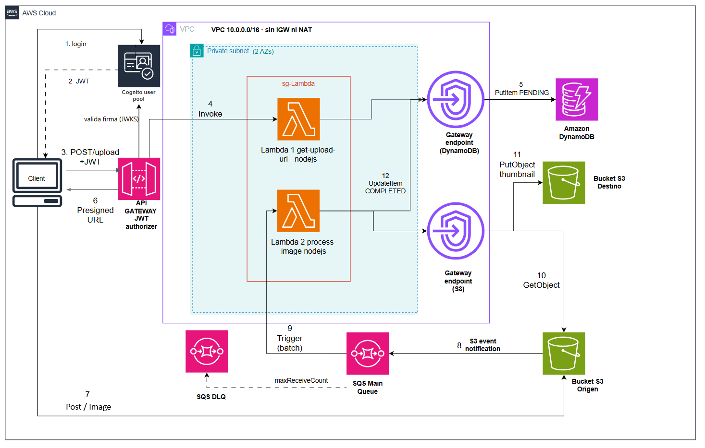
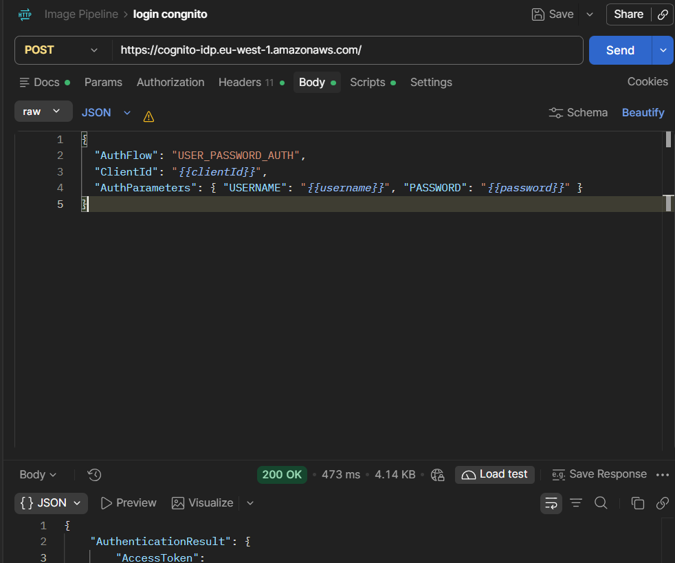
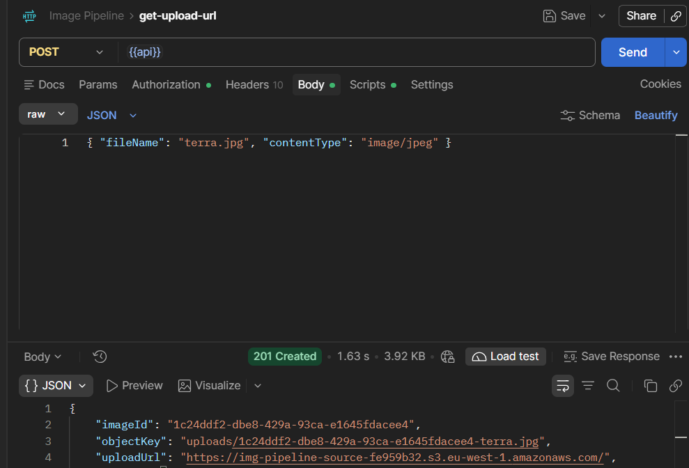
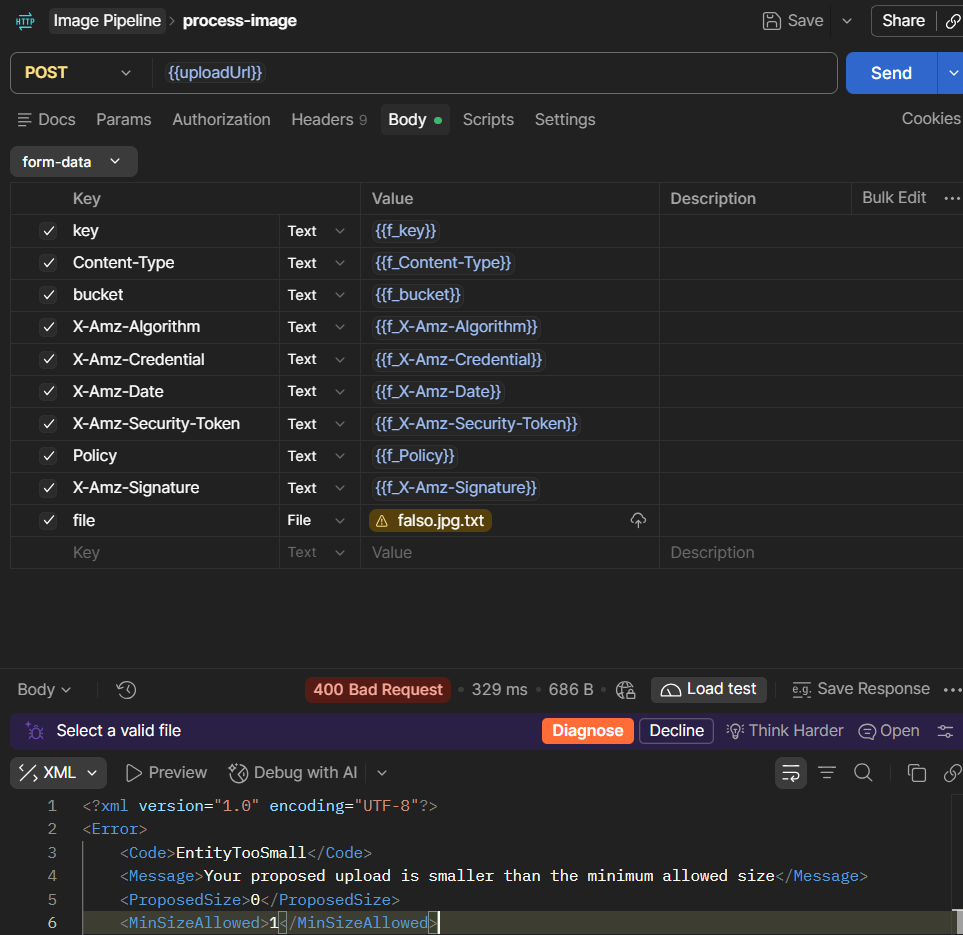
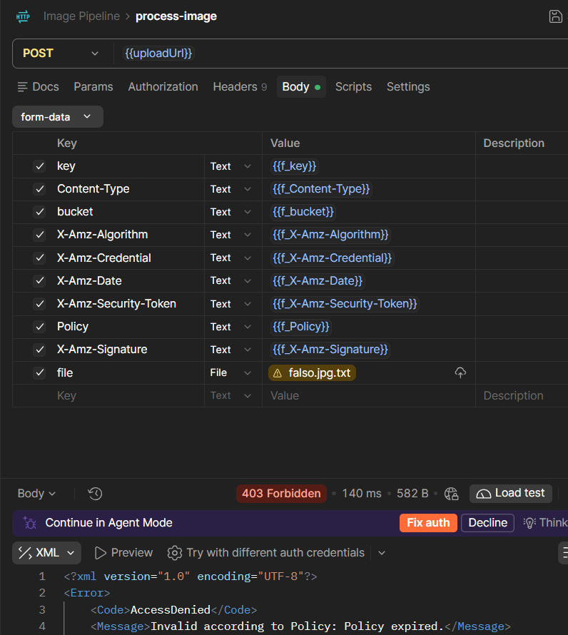
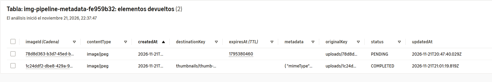
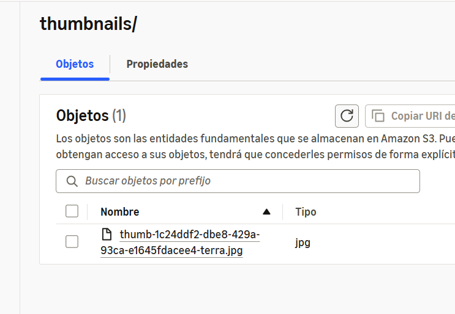
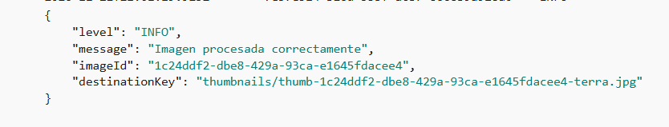
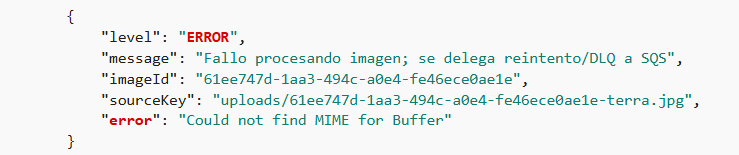
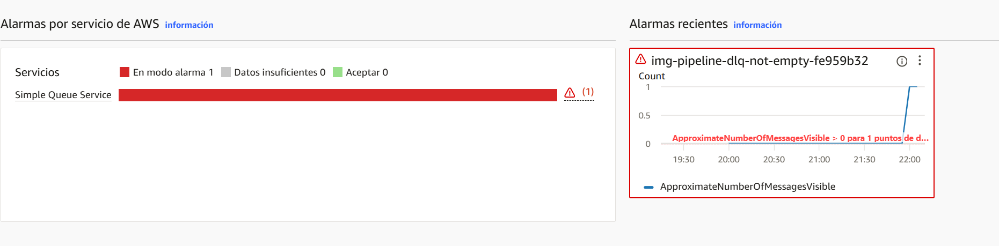

# Pipeline serverless de procesamiento de imágenes en AWS


Arquitectura **event-driven y 100 % serverless** que permite a usuarios autenticados subir imágenes de forma segura y genera miniaturas automáticamente. Toda la infraestructura (47 recursos) está definida como código con **Terraform**, se desplegó y probó end-to-end en AWS y se destruyó después para no generar costes.

> **Objetivo del proyecto:** demostrar criterio de arquitectura en AWS: desacoplamiento, seguridad por capas, resiliencia ante fallos, observabilidad y optimización de costes. Cada decisión está justificada en la sección [Decisiones de diseño](#decisiones-de-diseño).

---

## Índice
- [Arquitectura](#arquitectura)
- [Flujo paso a paso](#flujo-paso-a-paso)
- [Servicios utilizados](#servicios-utilizados)
- [Decisiones de diseño](#decisiones-de-diseño)
- [Seguridad](#seguridad-defensa-en-profundidad)
- [Resiliencia y manejo de errores](#resiliencia-y-manejo-de-errores)
- [AWS Well-Architected Framework](#aws-well-architected-framework)
- [Pruebas y evidencias](#pruebas-y-evidencias)
- [Costes](#costes)
- [Cómo desplegarlo](#cómo-desplegarlo)
- [Limitaciones conocidas y mejoras futuras](#limitaciones-conocidas-y-mejoras-futuras)
- [Preguntas de entrevista que responde este proyecto](#preguntas-de-entrevista-que-responde-este-proyecto)

---

## Arquitectura



**Principios aplicados:**
- **La imagen nunca pasa por la API ni por Lambda 1**: el cliente la sube directamente a S3 con un *Presigned POST*.
- **Procesamiento asíncrono y desacoplado**: S3 → SQS → Lambda, con reintentos y *Dead Letter Queue*.
- **Red privada sin salida a Internet**: las Lambdas viven en subredes privadas sin IGW ni NAT, y llegan a S3 y DynamoDB solo a través de **VPC Gateway Endpoints**.
- **Mínimo privilegio en todas las capas**: IAM, políticas de endpoint, políticas de bucket y de cola.

## Flujo paso a paso

| # | Paso | Detalle |
|---|------|---------|
| 1–2 | **Login** | El usuario se autentica en **Cognito** y recibe un JWT. El registro público está deshabilitado: solo un administrador crea cuentas. |
| 3 | **`POST /upload` + JWT** | El cliente pide permiso para subir una imagen indicando `fileName` y `contentType`. |
| 4 | **Autorización + invocación** | **API Gateway** valida la firma del JWT contra Cognito (JWT authorizer) e invoca a **Lambda 1** (`get-upload-url`). Sin token válido → `401`. |
| 5 | **Registro `PENDING`** | Lambda 1 valida el tipo (solo JPEG/PNG), sanea el nombre, genera un UUID y crea el registro en **DynamoDB** con estado `PENDING` y un TTL de 24 h. |
| 6 | **Presigned POST** | Lambda 1 devuelve una URL firmada válida **5 minutos**, con tamaño limitado a **1 byte – 5 MB** y `Content-Type` fijado. |
| 7 | **`POST` de la imagen** | El cliente sube la imagen **directamente al bucket S3 origen**. S3 aplica las condiciones de la firma. |
| 8 | **Evento S3 → SQS** | S3 publica el evento `ObjectCreated` en la cola **SQS**. |
| 9 | **Trigger** | SQS invoca a **Lambda 2** (`process-image`). |
| 10 | **Lectura** | Lambda 2 descarga la imagen original desde S3 a través del **Gateway Endpoint**. |
| 11 | **Miniatura** | Genera una miniatura de máx. 200×200 px y la guarda en el **bucket S3 destino**. |
| 12 | **`COMPLETED`** | Actualiza DynamoDB a `COMPLETED` con metadatos (ancho, alto, tamaño, MIME) y elimina el TTL para conservar el registro. |

Si el procesamiento falla, SQS reintenta 3 veces y después mueve el mensaje a la **DLQ**, lo que dispara una **alarma de CloudWatch** (ver [Resiliencia](#resiliencia-y-manejo-de-errores)).

## Servicios utilizados

| Servicio | Función en la arquitectura |
|----------|----------------------------|
| **Amazon Cognito** | Identidad de usuarios y emisión de JWT. Alta solo por administrador. |
| **API Gateway (HTTP API)** | Punto de entrada único, autorizador JWT y throttling (5 req/s, ráfaga 10). |
| **AWS Lambda** (×2, Node.js 24) | `get-upload-url`: firma la subida. `process-image`: genera la miniatura. |
| **Amazon S3** (×2) | Bucket origen (originales) y bucket destino (miniaturas), ambos privados. |
| **Amazon SQS** + DLQ | Buffer entre S3 y Lambda; reintentos y aislamiento de mensajes fallidos. |
| **Amazon DynamoDB** | Estado y metadatos de cada imagen. Modo on-demand y TTL. |
| **Amazon VPC** | Subredes privadas en 2 AZ, sin IGW/NAT, con Gateway Endpoints para S3 y DynamoDB. |
| **CloudWatch + SNS** | Logs con retención de 14 días y alarma cuando la DLQ recibe mensajes. |
| **IAM** | Un rol por Lambda con permisos limitados a acciones, recursos y prefijos concretos. |
| **Terraform** | Toda la infraestructura como código (47 recursos), empaquetado de Lambdas incluido. |

## Decisiones de diseño

Cada decisión se tomó comparando alternativas. Esta sección es el núcleo del proyecto.

### 1. Presigned POST en lugar de subir la imagen a través de API Gateway
- **Alternativa descartada:** enviar la imagen en el body de la API hacia Lambda.
- **Por qué:** API Gateway limita el payload a 10 MB y Lambda a 6 MB, y pagarías tiempo de Lambda solo por mover bytes. Con el Presigned POST, **S3 recibe la imagen directamente** y escala sin límite.
- **Por qué POST y no PUT:** el Presigned **POST** permite imponer condiciones que S3 valida en el servidor: **`content-length-range`** (1 B – 5 MB) y `Content-Type` exacto. Un Presigned PUT no permite limitar el tamaño.

### 2. SQS entre S3 y Lambda en lugar de invocar Lambda directamente desde S3
- **Alternativa descartada:** notificación S3 → Lambda directa.
- **Por qué:** SQS añade **buffer ante picos**, **reintentos controlados** (`maxReceiveCount = 3`) y una **DLQ** donde los mensajes fallidos quedan aislados 14 días para analizarlos, en lugar de perderse.
- **Detalle clave:** el *visibility timeout* de la cola es **180 s = 6 × el timeout de la Lambda (30 s)**, como recomienda AWS. Así un mensaje no reaparece mientras otra ejecución aún lo procesa.

### 3. Lambdas en VPC privada con Gateway Endpoints en lugar de NAT Gateway
- **Alternativa descartada:** subredes privadas con NAT Gateway.
- **Por qué:** los **Gateway Endpoints de S3 y DynamoDB son gratuitos**, mientras que un NAT Gateway cuesta unos 35 USD/mes más el tráfico. El tráfico nunca sale a Internet.
- **El endpoint no es solo una ruta, es un control de seguridad:** cada endpoint tiene una **política propia** que solo permite las acciones exactas del pipeline (`GetObject` en el origen, `PutObject` en el destino, `PutItem`/`UpdateItem` en la tabla). Aunque el código fuera comprometido, **no podría sacar datos hacia otro bucket**.
- **Security Group** con salida restringida a DNS (VPC+2) y HTTPS hacia los *prefix lists* de los endpoints. Sin reglas de entrada.

### 4. HTTP API en lugar de REST API
- **Por qué:** alrededor de un 70 % más barata, menor latencia y autorizador JWT nativo para Cognito.
- **Compromiso aceptado:** HTTP API **no admite AWS WAF**. Para producción, podriamos utilizar CloudFront delante.

### 5. DynamoDB on-demand con TTL
- **Por qué on-demand:** el tráfico es impredecible y en reposo el coste es 0.
- **TTL:** cada registro nace con `expiresAt` (24 h). Si la subida se abandona o el procesamiento falla, **DynamoDB lo borra solo**. Al completarse, Lambda 2 elimina `expiresAt` y el registro se conserva.

### 6. Ciclo de vida de los datos
- Los originales en `uploads/` **expiran a los 7 días** (solo se necesitan para generar la miniatura) y las subidas multipart incompletas se eliminan en 24 h.
- Los logs de CloudWatch tienen **retención de 14 días** (por defecto serían indefinidos y con coste creciente).

### 7. Estado de Terraform local
- **Decisión consciente para un proyecto de demo de un solo usuario** que se despliega, se prueba y se destruye.
- **En un equipo o en producción** usaría un **backend S3** con cifrado, versionado y bloqueo nativo (`use_lockfile`), y despliegue desde CI/CD.

## Seguridad (defensa en profundidad)

| Capa | Control |
|------|---------|
| **Identidad** | Cognito con alta solo por administrador; API protegida por JWT authorizer (`401` sin token). |
| **API** | Throttling; validación de entrada (JSON, campos obligatorios, allowlist de MIME → `415`); errores genéricos sin filtrar detalles internos. |
| **Subida** | Presigned POST de 5 min, tamaño 1 B – 5 MB, `Content-Type` fijado y **clave del objeto decidida por el servidor** (UUID + nombre saneado), nunca por el cliente. |
| **Contenido** | Lambda 2 valida la imagen por sus **bytes reales**: un archivo disfrazado de `.jpg` es rechazado aunque declare `image/jpeg`. |
| **Allowlist mínima de formatos** | Solo JPEG y PNG. Cada formato extra es un decodificador más expuesto a archivos no confiables. |
| **Red** | Lambdas sin acceso a Internet; Gateway Endpoints con políticas restrictivas; SG solo con salida. |
| **Almacenamiento** | Buckets privados (Block Public Access), cifrado SSE-S3, política que **deniega todo tráfico sin TLS**; el bucket destino **solo acepta escrituras desde el VPC Endpoint** (`aws:SourceVpce`). |
| **Mensajería** | Cola cifrada (SSE-SQS); solo el bucket origen puede publicar, validando `aws:SourceArn` **y** `aws:SourceAccount` (protección *confused deputy*). |
| **IAM** | Un rol por Lambda, acciones mínimas y recursos acotados por prefijo (`uploads/*`, `thumbnails/*`). |
| **Datos** | DynamoDB cifrada en reposo; logs estructurados en JSON sin datos sensibles. |

## Resiliencia y manejo de errores

```
Imagen inválida ─► Lambda 2 falla ─► SQS reintenta (×3, cada 180 s) ─► DLQ ─► Alarma CloudWatch ─► SNS
                                                                                       │
                     Registro en DynamoDB queda PENDING ─► TTL lo elimina en 24 h ◄────┘
```

| Situación | Comportamiento |
|-----------|----------------|
| Archivo vacío o > 5 MB | **S3 lo rechaza** en la subida (`EntityTooSmall` / `EntityTooLarge`). Nunca entra al pipeline. |
| Firma caducada (> 5 min) | **S3 lo rechaza** (`Policy expired`). |
| Tamaño fuera de rango en el evento | Lambda 2 marca `REJECTED` **sin reintentar** (error definitivo). |
| Contenido que no es una imagen | Lambda 2 lanza el error → 3 reintentos → **DLQ** → **alarma**. |
| Fallo transitorio (p. ej. throttling) | Los reintentos de SQS lo resuelven sin intervención. |

Se distingue entre **errores definitivos** (se descartan sin reintentar) y **errores potencialmente transitorios** (se relanzan para que SQS reintente).

## AWS Well-Architected Framework

| Pilar | Cómo se aplica |
|-------|----------------|
| **Excelencia operacional** | 100 % IaC con Terraform; logs JSON estructurados; alarma sobre la DLQ; retención de logs definida. |
| **Seguridad** | Ver [tabla de seguridad](#seguridad-defensa-en-profundidad): mínimo privilegio, cifrado en tránsito y en reposo, red privada, validación en varias capas. |
| **Fiabilidad** | Desacoplamiento con SQS; reintentos y DLQ; subredes en 2 AZ; servicios gestionados multi-AZ (S3, DynamoDB, SQS). |
| **Eficiencia de rendimiento** | Subida directa a S3 (sin cuellos de botella en la API); procesamiento asíncrono; 512 MB en Lambda 2 para más CPU. |
| **Optimización de costes** | Serverless pago por uso; Gateway Endpoints gratuitos en lugar de NAT; DynamoDB on-demand; ciclo de vida en S3 y TTL. |
| **Sostenibilidad** | Sin capacidad ociosa: cero cómputo cuando no hay tráfico; datos temporales que expiran solos. |

## Pruebas y evidencias

La infraestructura se desplegó en `eu-west-1` y se probó end-to-end con **Postman** ([colección incluida](docs/postman/image-pipeline.postman_collection.json)) y la consola de AWS.

| # | Prueba | Resultado esperado | Resultado |
|---|--------|--------------------|-----------|
| 1 | Login en Cognito | `200` + JWT | ✅ |
| 2 | Solicitar URL de subida con JWT | `201` + Presigned POST | ✅ |
| 3 | Subir archivo vacío | Rechazo de S3 (`EntityTooSmall`) | ✅ |
| 4 | Subir con firma caducada | Rechazo de S3 (`Policy expired`) | ✅ |
| 5 | Subir imagen JPEG válida | `204`, miniatura generada, estado `COMPLETED` | ✅ |
| 6 | Subir archivo de texto disfrazado de `.jpg` | 3 reintentos → DLQ → alarma en rojo | ✅ |

<details>
<summary><b>1. Login en Cognito → 200 + JWT</b></summary>


</details>

<details>
<summary><b>2. Solicitud de URL de subida → 201</b></summary>

La clave del objeto (`uploads/<uuid>-terra.jpg`) la genera el servidor; el cliente no controla dónde se guarda el archivo.


</details>

<details>
<summary><b>3. Archivo vacío rechazado por S3 (content-length-range)</b></summary>


</details>

<details>
<summary><b>4. Firma caducada rechazada por S3</b></summary>


</details>

<details>
<summary><b>5. DynamoDB: un registro COMPLETED y uno PENDING con TTL</b></summary>

El registro `COMPLETED` ya no tiene `expiresAt` (se conserva); el `PENDING` corresponde a una subida que nunca llegó a S3 y será eliminado por el TTL.


</details>

<details>
<summary><b>6. Miniatura generada en el bucket destino</b></summary>


</details>

<details>
<summary><b>7. Log estructurado de procesamiento correcto</b></summary>


</details>

<details>
<summary><b>8. Archivo no válido: error al decodificar y reintento delegado a SQS</b></summary>

El archivo declaraba `image/jpeg`, pero su contenido era texto: la validación por bytes reales lo detecta.


</details>

<details>
<summary><b>9. Mensaje en la DLQ → alarma de CloudWatch en rojo</b></summary>


</details>

## Costes

Estimación aproximada en `eu-west-1` (verificable con la [AWS Pricing Calculator](https://calculator.aws/)):

| Escenario | Coste aproximado |
|-----------|------------------|
| **Infraestructura en reposo** (sin tráfico) | **~0,10 USD/mes** (solo la alarma de CloudWatch; el resto es pago por uso) |
| **10.000 imágenes procesadas** | **< 0,50 USD** (Lambda, peticiones S3, DynamoDB y API Gateway), sin contar la capa gratuita |
| Lo que **no** se paga gracias al diseño | NAT Gateway (~35 USD/mes + tráfico), servidores encendidos, capacidad aprovisionada |

## Cómo desplegarlo

### Requisitos
- Cuenta de AWS y **AWS CLI** configurada con un usuario IAM (no root).
- **Terraform ≥ 1.6** y **Node.js ≥ 20** (para empaquetar las Lambdas).

### Despliegue
```bash
cd terraform
terraform init
terraform plan -out=tfplan        # opcional: -var="alarm_email=tu@email.com"
terraform apply tfplan
```
Terraform instala las dependencias de las Lambdas, las empaqueta y crea los 47 recursos (2–5 minutos).

### Crear un usuario de prueba
```bash
POOL=$(terraform output -raw cognito_user_pool_id)
aws cognito-idp admin-create-user --user-pool-id $POOL --username demo-user --message-action SUPPRESS
aws cognito-idp admin-set-user-password --user-pool-id $POOL --username demo-user --password "<contraseña>" --permanent
```

### Probar
1. Importa en Postman [`docs/postman/image-pipeline.postman_collection.json`](docs/postman/image-pipeline.postman_collection.json).
2. En las variables de la colección, rellena `api` y `clientId` (de `terraform output`) y `password`.
3. Ejecuta en orden: **1 → 2 → 3** (las peticiones 2 y 3 seguidas: la firma dura 5 minutos). En la 3, selecciona una imagen JPEG en el campo `file`.
4. Comprueba el estado `COMPLETED` en DynamoDB y la miniatura en el bucket destino.

### Destruir
```bash
terraform destroy
```

### Estructura del repositorio
```
├── docs/
│   ├── architecture.png          # Diagrama de arquitectura
│   ├── postman/                  # Colección de Postman
│   └── screenshots/              # Evidencias de las pruebas
├── src/
│   ├── get-upload-url/           # Lambda 1: valida y genera el Presigned POST
│   └── process-image/            # Lambda 2: genera la miniatura
└── terraform/
    ├── api.tf                    # API Gateway + JWT authorizer
    ├── auth.tf                   # Cognito
    ├── compute.tf                # Lambdas + trigger SQS
    ├── iam.tf                    # Roles de mínimo privilegio
    ├── messaging.tf              # SQS + DLQ + notificación S3
    ├── network.tf                # VPC, subredes, endpoints, SG
    ├── observability.tf          # Logs, alarma, SNS
    ├── storage.tf                # S3 + DynamoDB
    └── variables.tf / outputs.tf / main.tf
```

## Limitaciones conocidas y mejoras futuras

Este proyecto prioriza demostrar la arquitectura. Para llevarlo a producción, añadiría:

| Área | Mejora |
|------|--------|
| **Seguridad perimetral** | AWS WAF (requiere REST API o CloudFront delante, ya que HTTP API no lo admite). |
| **Identidad** | MFA en Cognito, flujo SRP en lugar de `USER_PASSWORD_AUTH`, política de contraseñas más estricta. |
| **Funcionalidad** | Endpoint `GET /images/{id}` que devuelva el estado y una URL firmada de la miniatura, verificando que la imagen pertenece al usuario (`sub` del JWT). |
| **Protección del procesamiento** | Límite de megapíxeles antes de decodificar (protección contra *decompression bombs*). |
| **Observabilidad** | Access logs de API Gateway, trazas con X-Ray, alarmas de errores de Lambda y 5xx. |
| **Infraestructura como código** | Backend remoto S3 con bloqueo; pipeline CI/CD con `terraform validate`, `tflint` y `checkov`. |
| **Calidad** | Tests unitarios de las Lambdas con AWS simulado. |
| **Costes / rendimiento** | Lambdas en `arm64` (Graviton, ~20 % más baratas) y concurrencia reservada. |

## Preguntas de entrevista que responde este proyecto

<details>
<summary><b>¿Por qué la imagen no pasa por tu API?</b></summary>

Porque API Gateway (10 MB) y Lambda (6 MB) tienen límites de payload, y pagaría cómputo solo por mover bytes. Con un Presigned POST la API solo autoriza; S3 recibe el archivo directamente y aplica los límites de tamaño y tipo en el servidor.
</details>

<details>
<summary><b>¿Qué pasa si una imagen falla al procesarse?</b></summary>

La Lambda relanza el error, el mensaje vuelve a SQS y se reintenta hasta 3 veces. Si sigue fallando, pasa a la DLQ (retención 14 días), una alarma de CloudWatch avisa por SNS y el registro `PENDING` se limpia solo por TTL. Lo probé con un archivo de texto renombrado a `.jpg`.
</details>

<details>
<summary><b>¿Por qué el visibility timeout es de 180 segundos?</b></summary>

AWS recomienda al menos 6 veces el timeout de la función cuando SQS dispara una Lambda. Con 30 s de timeout, 180 s evita que un mensaje vuelva a ser visible y se procese dos veces mientras otra invocación todavía trabaja en él.
</details>

<details>
<summary><b>¿Para qué meter las Lambdas en una VPC si no acceden a recursos privados?</b></summary>

Para controlar la salida de datos: sin NAT ni IGW, la única forma de llegar a AWS es por los Gateway Endpoints, y sus políticas solo permiten las operaciones exactas del pipeline sobre mis recursos. Además, el bucket destino rechaza escrituras que no vengan de ese endpoint.
</details>

<details>
<summary><b>¿Por qué Gateway Endpoints y no NAT Gateway?</b></summary>

Coste y seguridad: los Gateway Endpoints de S3 y DynamoDB son gratuitos y el tráfico no sale a Internet; un NAT Gateway costaría unos 35 USD/mes más el tráfico y abriría salida a cualquier destino.
</details>

<details>
<summary><b>¿Qué es el problema del "confused deputy" y cómo lo evitas?</b></summary>

Un servicio de AWS (S3) actuando en nombre de otra cuenta podría usar mis permisos. Como los nombres de bucket son globales, la política de SQS valida tanto `aws:SourceArn` (mi bucket) como `aws:SourceAccount` (mi cuenta).
</details>

<details>
<summary><b>¿Cómo gestionarías el estado de Terraform en un equipo?</b></summary>

Con un backend S3 cifrado y versionado, con bloqueo nativo (`use_lockfile`) para evitar applies concurrentes, permisos IAM restringidos sobre el bucket del estado y despliegues desde CI/CD en lugar de desde portátiles.
</details>

---

**Autor:** Elie Abud· [LinkedIn](https://www.linkedin.com/in/elie-abud-231a7a282/) · [GitHub](https://github.com/elieabudk)
